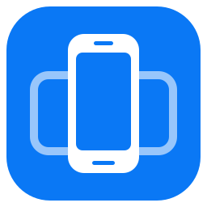
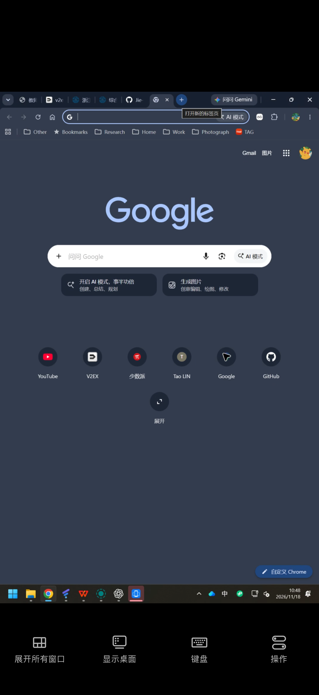
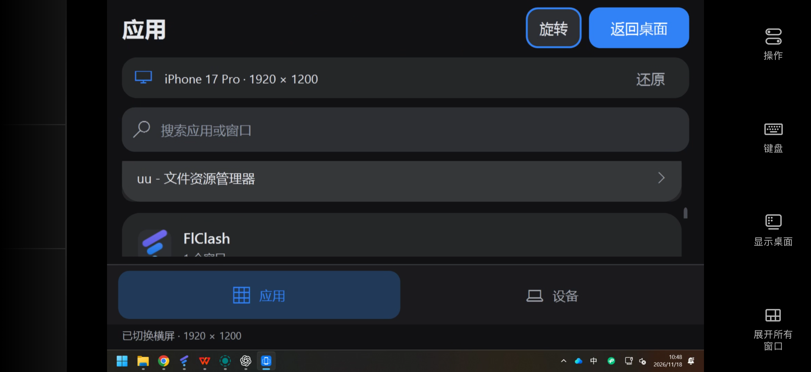

<div align="center">

[简体中文](README.md) · **English**



# PocketDesk

**A Windows workspace for your phone and tablet**

Built for an existing UU Remote virtual display · Window library · Manual rotation · Session recovery

[](https://github.com/Jie-su/PocketDesk/releases/tag/v0.2.1)


[](TESTING.md)
[](LICENSE)

[Download](#download) · [Features](#features) · [Install](#install) · [Usage](#usage) · [Limitations](#known-limitations) · [Development](#development)

</div>

PocketDesk is an independent Windows implementation inspired by [Snug](https://github.com/zephyr4123/snug), built with C#, WPF and Win32. **It is not an official Windows edition of Snug or a NetEase product.** It uses a virtual display already created by UU Remote; it does not install a display driver or create the display itself.

## Download

**[Download v0.2.1 pre-release](https://github.com/Jie-su/PocketDesk/releases/tag/v0.2.1)** · [All releases](https://github.com/Jie-su/PocketDesk/releases)

**Windows 11 x64 recommended.** Other Windows versions supported by .NET 10 have not been fully validated; see [Microsoft's compatibility table](https://learn.microsoft.com/en-us/dotnet/core/install/windows). Extract the complete self-contained archive and run `PocketDesk.exe`; a separate .NET installation is not required. This release is unsigned and has no automatic updater.

## Screenshots

| Phone portrait | Phone landscape |
| :---: | :---: |
|  |  |

## Features

- **New in 0.2.1:** Open pinned apps and switch running windows in the same panel. Swipe to scroll, use optional scroll buttons, or hold and drag to select text. Selecting a supported window, including the packaged ChatGPT desktop app, can zoom it in one step.
- **A library of real running windows.** Grouped by application with icons, titles and search. Select a window to place it in the workspace; switching applications restores the previous window.
- **Phone and tablet profiles.** Read the single active controller from UU's local “本机被控中” section. Automatic adaptation and device preferences are saved.
- **Whole-frame display sizing.** Adapt the virtual display resolution so the Windows taskbar is included. If the ideal resolution is rejected, use only enumerated candidates satisfying the configured margin checks.
- **Exact manual rotation.** Swap width and height using an enumerated driver mode. The verified pair is **1200×1920 ↔ 1920×1200**. Missing or invalid exact modes leave the current display unchanged.
- **Responsive navigation.** A side rail on wider views, bottom navigation on narrow views, and one to three columns of application cards. The compact toolbar provides Apps & Windows and Actions.
- **System, light and dark themes.** Shared by the window and toolbar, with saved preferences.
- **Recovery records before changes.** Preserve the original display mode and window geometry/state. Normal exit, a recovery helper and startup retries use the journal; unconfirmed recovery retains evidence.
- **Limited text-size controls.** Supported Windows Terminal, VS Code, Cursor and packaged ChatGPT windows require foreground checks. Uncertain changes are retained for manual resolution rather than blindly reversed.

| Profile | Native portrait pixels | Logical short edge | Default direction |
| --- | --- | --- | --- |
| iPhone 17 Pro | 1206×2622 | 402 | Portrait |
| iPad Pro 11-inch, 3rd generation | 1668×2388 | 834 | Keep current direction |

The driver determines supported resolutions. The catalog currently contains these two profiles. A reliably identified PC, unknown model or multiple controllers will not be inferred to be a phone from a common resolution such as 4K.

## Install

1. Install and connect [UU Remote](https://uuyc.163.com/) on the Windows host and mobile device.
2. Download and extract the Windows x64 archive in full.
3. Start `PocketDesk.exe`, enable UU's virtual display and select it in the mobile client.
4. Leave device auto-adaptation enabled. If identification is temporarily unavailable, open UU's main window so its local controller section can be read.

Controller detection is read-only. PocketDesk does not activate or restore UU's window. UU manages virtual displays and physical monitor topology.

## Usage

1. Connect a supported single device for automatic adaptation, or select a display manually in device settings.
2. Search for a running window and select its row.
3. Expand **Apps & Windows** and tap a window to switch to it. **Actions** contains rotation, supported text-size controls and session completion.
4. Rotate with the UI or `Ctrl + Alt + F11`; return to the workspace with `Ctrl + Alt + F12`.
5. Finish and restore the workspace before leaving UU's virtual display. Manual completion suppresses automatic reopening for the current connection.

More details: [User guide](docs/user-guide.md) and [How it works](docs/how-it-works.md) (Chinese).

## Known limitations

- UU provides the display, streaming and input. Swipe scrolling needs continuous pointer events from UU and an app that accepts window messages. Rotation is manual; no mobile orientation sensor channel is available.
- Modes require driver preflight and read-back. Application minimum sizes, elevated windows, secure desktops, exclusive fullscreen and other virtual desktops are outside the initial guarantees.
- UU updates or inaccessible UI can return Unknown. Unknown with an attached display is not proof of disconnection; finish the session manually when necessary.
- Common fallback resolutions can also belong to a PC. Automatic recovery defers with the full journal intact when controller evidence is insufficient. Physical monitor enablement/topology managed by UU is not guaranteed to be restored.
- At approximately 643×378 logical pixels, the first application action row may require scrolling.
- **211 local regression tests passed.** On an iPhone 17 Pro connected through UU, the Windows ChatGPT app zoomed in on entry and the conversation scrolled with one finger. Restoration of individual third-party windows still needs further device testing. Latency has not been measured. See [TESTING.md](TESTING.md).

## Development

Requires Windows x64, PowerShell 7 and the .NET 10 SDK:

```powershell
git clone https://github.com/Jie-su/PocketDesk.git
cd PocketDesk
./build.ps1 -Test -Publish -BuildDir artifacts/release-build -PublishDir artifacts/release-publish
```

Output: the isolated `artifacts/release-publish` directory, leaving the default development distribution untouched. Tests use pure data, read-only display queries and a dedicated WPF fixture; they do not change real display modes or send keys to user applications. CI uses the `-PureTest` subset; packaging commands are in the development guide.

[Development guide](docs/development.md) · [Verification](TESTING.md) · [Contribute screenshots](docs/screenshots/README.md) · [Report an issue](https://github.com/Jie-su/PocketDesk/issues)

## Acknowledgements and license

- [Snug](https://github.com/zephyr4123/snug): mobile workspace, display proportions and documentation structure.
- [UU Remote](https://uuyc.163.com/): the existing remote connection and virtual display.
- [FlClash](https://github.com/chen08209/FlClash): navigation and card-layout design reference.

Released under the [MIT License](LICENSE). See [THIRD_PARTY_NOTICES.md](THIRD_PARTY_NOTICES.md). PocketDesk is not officially affiliated with these projects.
