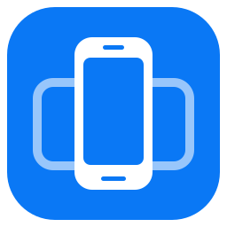
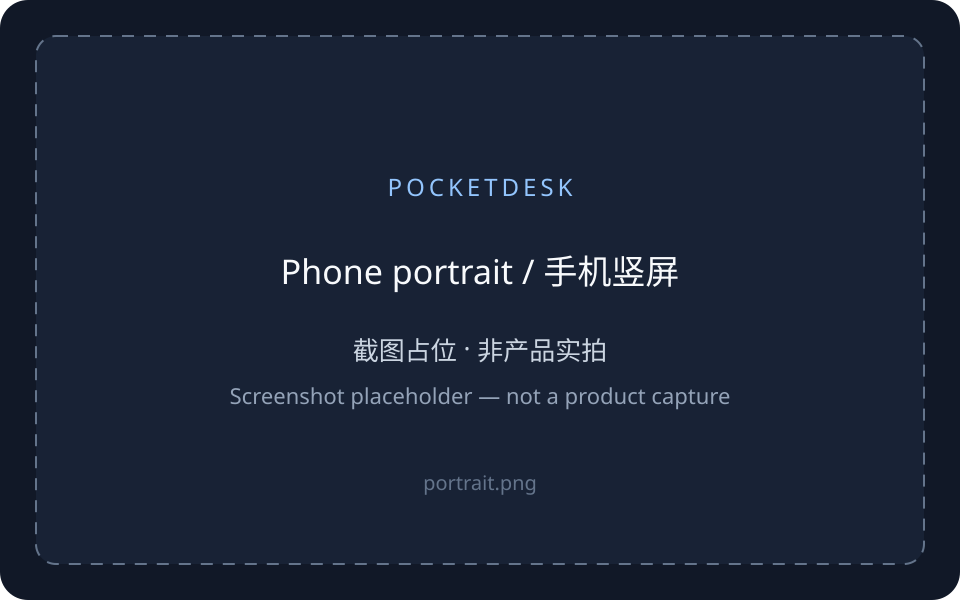
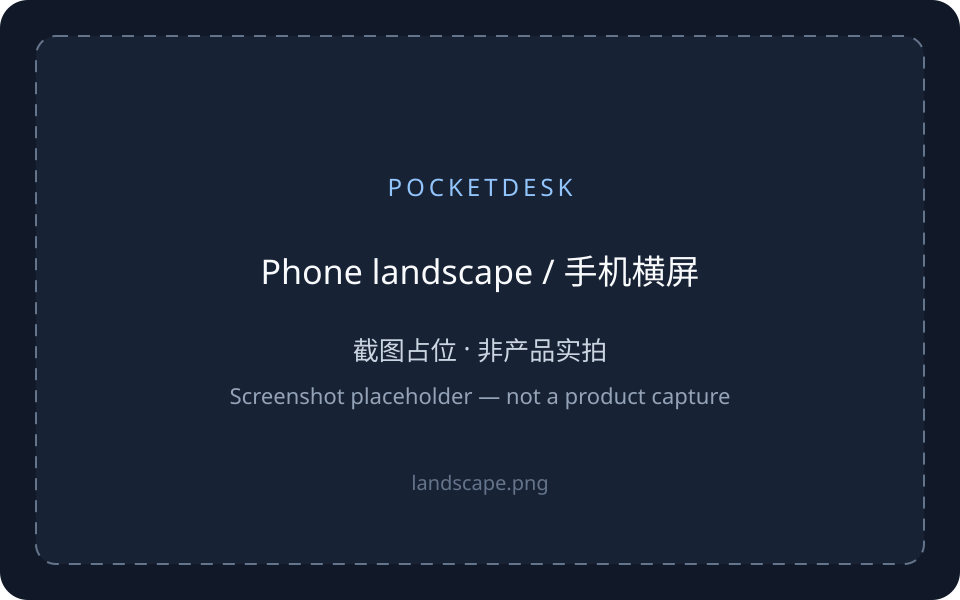
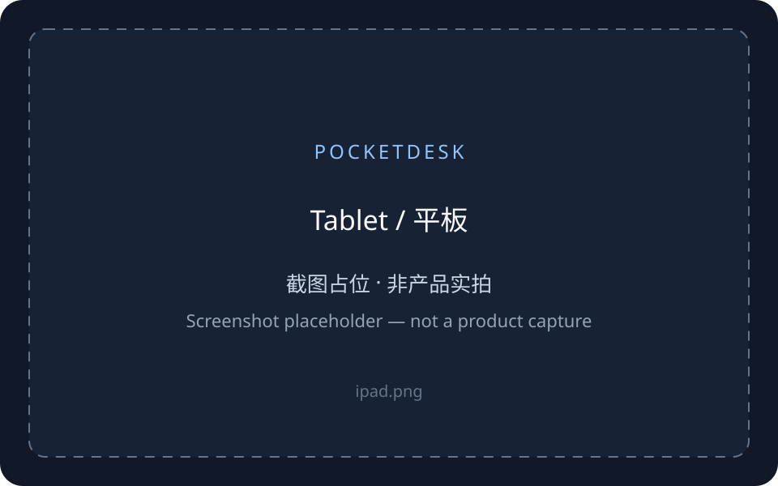
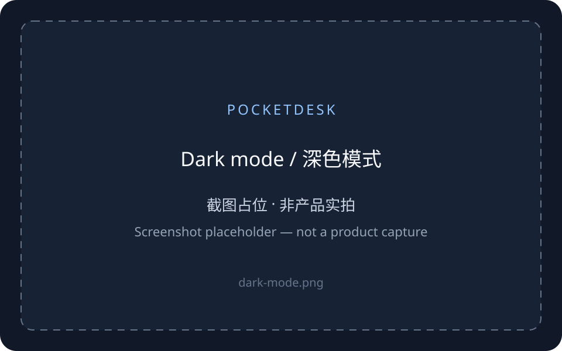

<div align="center">

**简体中文** · [English](README.en.md)



# PocketDesk

**把 Windows 窗口整理成适合手机和平板的工作台**

配合 UU 远程超级屏 · 应用窗口库 · 横竖屏切换 · 会话还原

[](https://github.com/Jie-su/PocketDesk/releases/tag/v0.1.0)


[](TESTING.md)
[](LICENSE)
[](https://github.com/Jie-su/PocketDesk/actions/workflows/ci.yml)

[下载](#下载) · [功能](#功能) · [安装](#安装) · [使用](#使用) · [限制](#已知限制) · [开发](#开发)

</div>

PocketDesk 是受 [Snug](https://github.com/zephyr4123/snug) 启发的独立 Windows 实现，使用 C#、WPF 与 Win32。**不是 Snug 或网易的官方 Windows 版本。** 它使用 UU 已创建的超级屏，不安装显示驱动、不自行创建虚拟屏。

## 下载

**[下载 v0.1.0 预发布版](https://github.com/Jie-su/PocketDesk/releases/tag/v0.1.0)** · [全部版本](https://github.com/Jie-su/PocketDesk/releases)

推荐 **Windows 11 x64**；其他受 .NET 10 支持的 Windows 版本尚未全面验证，参见 [Microsoft 兼容表](https://learn.microsoft.com/en-us/dotnet/core/install/windows)。自包含压缩包无需另装 .NET；解压整个发行目录后运行 `PocketDesk.exe`。首版为未签名预发布，不提供自动更新；更新方式见[使用指南](docs/user-guide.md)。

## 界面预览

以下是**截图占位图，不是产品实拍**。真实截图可放入 [docs/screenshots](docs/screenshots/README.md) 后替换。

| 手机竖屏 | 手机横屏 |
| :---: | :---: |
|  |  |
| 平板 | 深色模式 |
|  |  |

## 功能

- **真实窗口库**：按运行中的应用分组，显示图标和窗口标题；搜索后直接选中窗口进入工作区。切换应用时还原上一个窗口的位置。
- **手机 / 平板适配**：从 UU「本机被控中」读取当前控制者，支持已登记的 iPhone 17 Pro 和 iPad Pro 11 英寸（第 3 代）；自动适配开关与设备偏好可保存。
- **整帧尺寸调整**：调整 UU 显示模式，让 Windows 任务栏与窗口一起参与画面适配。理想模式不被驱动接受时，仅选择符合安全留边条件的枚举模式。
- **严格宽高互换**：手动旋转只使用驱动列出的精确交换尺寸。例如已验证的 **1200×1920 ↔ 1920×1200**；没有对应模式或未通过检查则保持现状，不改用另一比例。
- **触控尺寸的界面**：宽屏侧栏、窄屏底部导航、单 / 双 / 三列应用卡片，以及轻量「应用 / 操作」控制条。
- **浅色 / 深色 / 系统主题**：主窗和控制条同步更新，选择在重启后保留。
- **记录后再修改**：保存原始显示模式、窗口位置及状态。支持正常结束、重启重试和独立恢复助手；恢复无法确认时保留记录。
- **受限字号操作**：Terminal、VS Code、Cursor 使用应用白名单与前台检查；不确定的操作会保留记录，避免盲目反向调整。

### 设备支持

| 设备 | 原生像素（竖屏） | 界面逻辑短边 | 默认接入方向 |
| --- | --- | --- | --- |
| iPhone 17 Pro | 1206×2622 | 402 | 竖屏 |
| iPad Pro 11 英寸（第 3 代） | 1668×2388 | 834 | 保持当前方向 |

实际可用分辨率由 UU 显示驱动决定。可靠识别出的 PC、未知型号或多个控制者不会仅凭 4K 等常见尺寸被当成手机。设备目录目前只有上表两项，其他设备不保证自动适配。

## 安装

1. 在被控 Windows 电脑和手机 / 平板上安装并连接 [UU 远程](https://uuyc.163.com/)。
2. 从上面的发行页下载 Windows x64 压缩包，完整解压。
3. 打开 `PocketDesk.exe`，在 UU 中启用超级屏并选择该显示屏。
4. 保持「设备 → 自动适配 → 识别手机和平板」开启。若控制者暂时无法识别，请打开 UU 主窗口，使「本机被控中」可读。

PocketDesk 只读取 UU 可访问性界面，不主动激活或恢复 UU 窗口。超级屏及物理显示器拓扑由 UU 管理。

## 使用

1. **进入工作台**：已支持的单个设备连接后自动适配；也可在设备页手动选择目标屏。
2. **打开窗口**：在应用页搜索并点击窗口行，窗口会放到工作区。
3. **切换应用**：点控制条「应用」回到窗口库；「操作」中可旋转、调整受支持应用的字号或结束。
4. **横竖切换**：点旋转按钮，或按 `Ctrl + Alt + F11`。`Ctrl + Alt + F12` 返回工作台。
5. **结束并还原**：先结束工作台，再退出 UU 超级屏。手动结束会抑制本次连接自动重开。

详细设置、15 秒分辨率预览、恢复说明和本地数据见[使用指南](docs/user-guide.md)；实现边界见[工作原理](docs/how-it-works.md)。

## 已知限制

- **依赖 UU**：超级屏、视频传输和触控输入由 UU 提供。没有单指滚动 / 长按右键重映射，也没有手机方向传感器通道；旋转需手动触发。
- **驱动与应用差异**：分辨率必须通过预检和读回。最小窗口尺寸、管理员窗口、安全桌面、独占全屏及其他虚拟桌面不在首版保证范围。
- **只读识别可能暂时不可用**：UU 更新或面板不可读时会返回 Unknown。虚拟屏仍连接时，不能仅凭 Unknown 推断远程已结束；请手动「结束并还原」。
- **恢复需要证据**：标准备用模式可能与 PC 相同，自动恢复在控制者证据不足时保留完整记录等待重试，不冒险覆盖接管者的分辨率。不保证恢复 UU 管理的物理屏启用状态或拓扑。
- **短横屏需要滚动**：约 643×378 逻辑尺寸的应用页首个窗口操作行可能位于首屏下面，可以滚动访问。
- **首版验证范围有限**：186 项回归通过；手机横屏的左侧避让、任务栏点击、应用最小尺寸问题已获实机确认。最后一轮窗口恢复修复尚未再次实机退出验收，延迟也未量化。完整范围见 [TESTING.md](TESTING.md)。

## 开发

需要 Windows x64、PowerShell 和 .NET 10 SDK：

```powershell
git clone https://github.com/Jie-su/PocketDesk.git
cd PocketDesk
./build.ps1 -Test -Publish -BuildDir artifacts/release-build -PublishDir artifacts/release-publish
```

输出目录为隔离的 `artifacts/release-publish`，不覆盖默认开发发行目录。测试使用纯数据、只读显示查询和专用 WPF 测试窗口，不改真实显示模式、不向用户应用发送按键。CI 使用 `-PureTest` 子集；归档命令见开发指南。

[开发指南](docs/development.md) · [验证记录](TESTING.md) · [截图贡献](docs/screenshots/README.md) · [提交问题](https://github.com/Jie-su/PocketDesk/issues)

## 致谢与许可

- [Snug](https://github.com/zephyr4123/snug)：手机工作台与屏幕比例适配思路，以及文档组织参考。
- [UU 远程](https://uuyc.163.com/)：现有远程连接和超级屏能力。
- [FlClash](https://github.com/chen08209/FlClash)：宽窄屏导航和卡片界面的设计参考。

项目采用 [MIT 许可](LICENSE)，第三方说明见 [THIRD_PARTY_NOTICES.md](THIRD_PARTY_NOTICES.md)。上述项目与本项目均无官方隶属关系。
